# LendLoop

**Borrow what you need. Lend what you don't.**

A neighbourhood tool-lending board. Neighbours list tools, request to borrow them for a date range, and n8n handles the request notifications and overdue reminders.

**Stack:** Next.js 16 (App Router) · Clerk · Convex · n8n 2.48 · TypeScript · Tailwind CSS 4

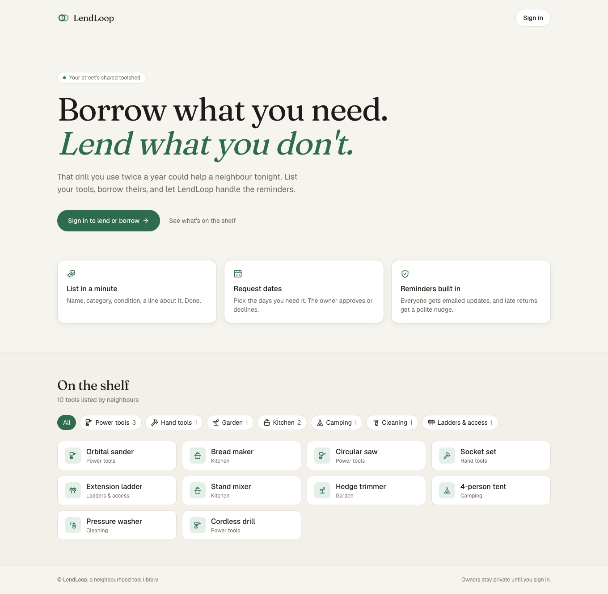

| Browse (signed in) | Incoming requests | My requests, with automation activity |
| --- | --- | --- |
| 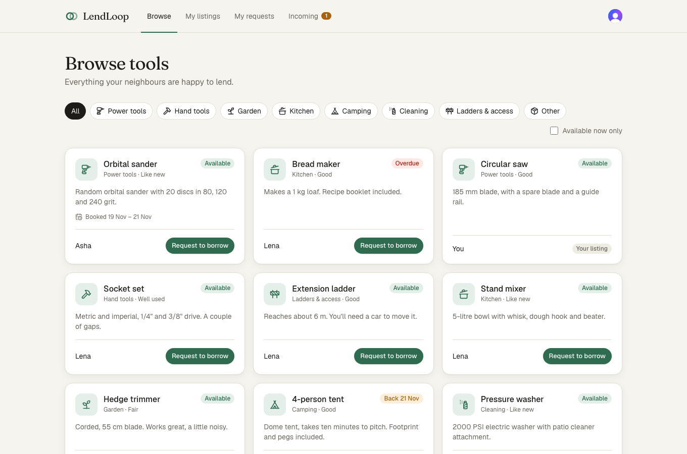 | 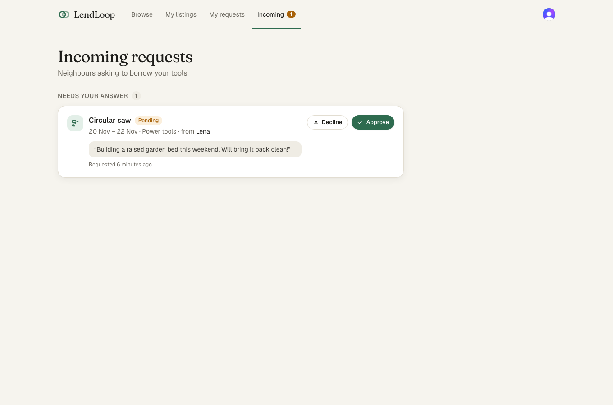 | 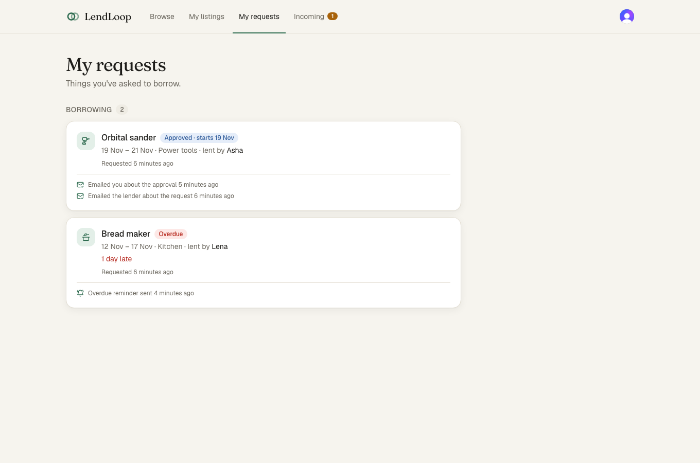 |

| Admin: automation health | Every email lands in Mailpit | Mobile, dark mode |
| --- | --- | --- |
| 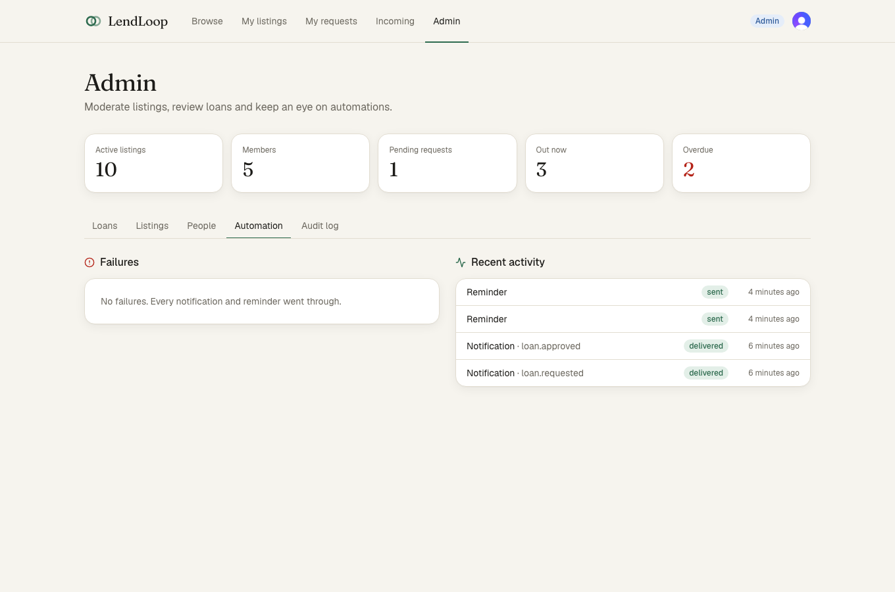 | 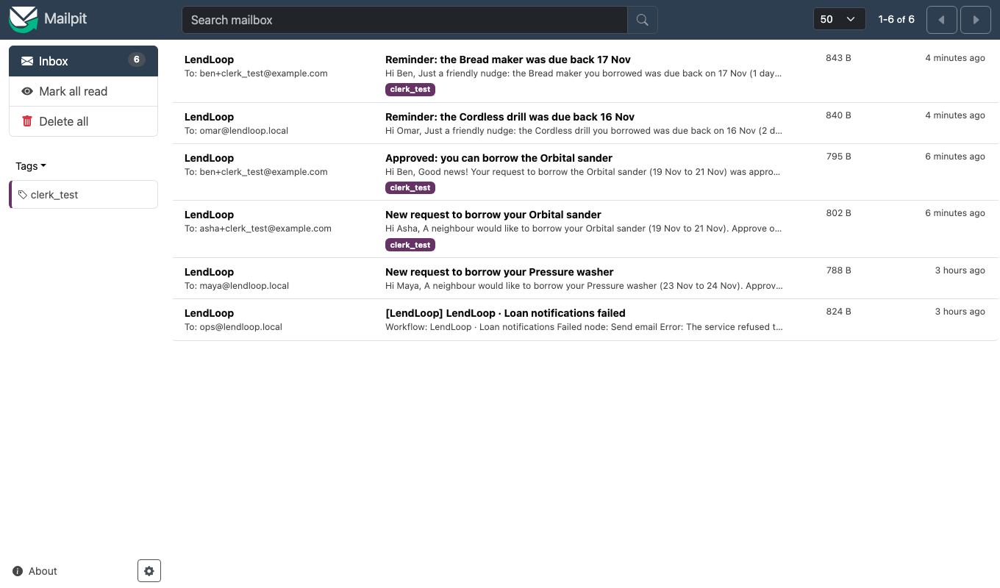 | 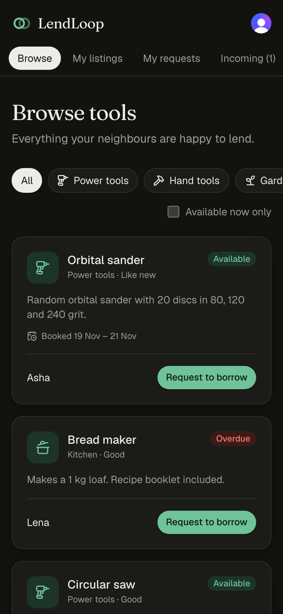 |

---

## Contents

1. [What's in the box](#whats-in-the-box)
2. [Run it locally](#run-it-locally)
3. [Environment variables](#environment-variables)
4. [Architecture](#architecture)
5. [Roles and access control](#roles-and-access-control)
6. [Securing the Convex ↔ n8n integration](#securing-the-convex--n8n-integration)
7. [Data minimisation](#data-minimisation)
8. [The n8n workflows](#the-n8n-workflows)
9. [Tests](#tests)
10. [What I'd change for production](#what-id-change-for-production)
11. [Project structure](#project-structure)

More detail: [docs/DECISIONS.md](docs/DECISIONS.md) covers the trade-offs, and [docs/PRODUCTION.md](docs/PRODUCTION.md) has the full production checklist.

---

## What's in the box

| Requirement | Where |
| --- | --- |
| Public page: tagline, read-only list (name and category only, live from Convex), "Sign in to lend or borrow" | `src/app/page.tsx`, `tools.listPublic` |
| List a tool with name, category, condition and short description | My listings → *List a tool* (`tools.create`) |
| Request a tool for a date range | Browse → *Request to borrow* (`loans.request`) |
| Approve or decline requests on your own tools; mark loans as returned | Incoming (`loans.approve` / `decline` / `markReturned`) |
| All tools with availability, filterable by category | Browse (`tools.browse`) |
| "My listings", "My requests" and "Incoming requests" views | `/listings`, `/requests`, `/incoming` |
| Admin: remove any listing, view all loans, mark a lender as Trusted Lender | `/admin` |
| RBAC enforced in Convex functions, not only in the UI | `convex/lib/auth.ts`, used by every function |
| n8n request-notification workflow (Convex → signed webhook) | `n8n/workflows/loan-notifications.json` |
| n8n daily overdue workflow (fetch → remind → write back) | `n8n/workflows/overdue-reminders.json` |
| HMAC signatures in both directions, secrets only in env and credentials | `convex/lib/signing.ts`, `n8n/code/*.js` |
| Idempotent write-backs, retries, an error workflow, no silent failures | [See below](#securing-the-convex--n8n-integration) |
| **Bonus:** recent automation activity on each loan ("Overdue reminder sent 2 days ago") | Activity lines on loan cards |

Extras: an append-only audit log, soft deletes, demo seed data, an admin "automation health" panel, dark mode, and a mobile layout.

---

## Run it locally

About 10 minutes. You need **Node 24+**, **Docker**, and a free **Clerk** account.

### 1. Install

```bash
git clone <this repo> lendloop && cd lendloop
npm install
```

### 2. Clerk (about 3 minutes in the dashboard)

1. Create an application at [dashboard.clerk.com](https://dashboard.clerk.com) with Email sign-in enabled.
2. **Configure → Integrations → Convex → Activate.** Note the *Frontend API URL*, for example `https://xxx.clerk.accounts.dev`.
3. **Configure → Sessions → Customize session token**, and paste the claims from [`docs/clerk-session-claims.json`](docs/clerk-session-claims.json). The Convex integration's token has no name or email by default, and LendLoop needs them for notifications.
4. **API keys:** copy the two keys into `.env.local`, using [`.env.example`](.env.example) as a template:
   ```bash
   NEXT_PUBLIC_CLERK_PUBLISHABLE_KEY=pk_test_...
   CLERK_SECRET_KEY=sk_test_...
   ```

### 3. Convex

```bash
npx convex dev          # keep this running
```

Choose a **local** deployment, either "start without an account" or log in and pick local. A local backend can call n8n on `localhost`; a cloud deployment can't (see the [note below](#using-convex-cloud-or-n8n-cloud-instead)). The command writes `NEXT_PUBLIC_CONVEX_URL` and `NEXT_PUBLIC_CONVEX_SITE_URL` into `.env.local`.

### 4. Secrets and n8n

In a second terminal:

```bash
CLERK_JWT_ISSUER_DOMAIN=https://xxx.clerk.accounts.dev npm run setup:local
docker compose up -d
```

`setup:local` generates two HMAC secrets and an n8n encryption key, writes them to `n8n/.env` (git-ignored, mode 600), and sets the matching variables on your Convex deployment. `docker compose up` starts Mailpit (a fake inbox) and n8n. A one-shot `n8n-bootstrap` container first imports the SMTP credential and the three workflows, then publishes them.

### 5. Run the app

```bash
npm run dev             # http://localhost:3000
```

Sign in once, then make yourself an admin and load demo data:

```bash
npx convex run users:setRole '{"email":"you@example.com","role":"admin"}'
npm run seed -- '{"email":"you@example.com"}'
```

The seed adds three neighbours and their tools, a request waiting for you, and an overdue loan you borrowed.

### 6. See the automations

| | URL |
| --- | --- |
| App | http://localhost:3000 |
| Mailpit (every email lands here) | http://localhost:8025 |
| n8n (create the owner account on first visit) | http://localhost:5678 |

* Request a tool from a second account. The lender's email appears in Mailpit, and the loan card shows *"Emailed the lender about the request"*.
* In n8n, open **LendLoop · Overdue reminders** and click *Execute workflow*. Overdue borrowers get a reminder, and *My requests* shows *"Overdue reminder sent just now"*. Run it again the same day and nothing is sent twice.
* Stop Mailpit (`docker compose stop mailpit`) and request something. The webhook run fails, the error workflow records it under **Admin → Automation**, and Convex retries with backoff until Mailpit is back.

#### Deploying to Vercel

`vercel.json` runs `npx convex deploy --cmd 'npm run build'`, which pushes the Convex functions to your production deployment and sets `NEXT_PUBLIC_CONVEX_URL` for the build. In Vercel, set `CONVEX_DEPLOY_KEY` (a production deploy key from the Convex dashboard), `NEXT_PUBLIC_CLERK_PUBLISHABLE_KEY` and `CLERK_SECRET_KEY`. On the Convex production deployment, set `CLERK_JWT_ISSUER_DOMAIN` (and the n8n variables if your n8n is publicly reachable; otherwise notifications are recorded as *skipped*).

#### Using Convex cloud or n8n cloud instead

Convex cloud functions can't reach `localhost`. Expose n8n with a tunnel, for example `cloudflared tunnel --url http://localhost:5678`, or use n8n Cloud. Then set `N8N_LOAN_EVENTS_WEBHOOK_URL` to the public webhook URL, and set `LENDLOOP_API_URL` in n8n to your deployment's `.convex.site` URL. On Linux, `host.docker.internal` resolves to the Docker bridge, so a Convex backend bound to `127.0.0.1` isn't reachable from the container. Run the backend on `0.0.0.0` or use a cloud deployment.

---

## Environment variables

No secret is ever in code or in the exported workflow JSON.

| Where | Variable | Purpose |
| --- | --- | --- |
| `.env.local` (Next.js) | `NEXT_PUBLIC_CONVEX_URL`, `NEXT_PUBLIC_CONVEX_SITE_URL`, `CONVEX_DEPLOYMENT` | Written by `npx convex dev` |
| | `NEXT_PUBLIC_CLERK_PUBLISHABLE_KEY`, `CLERK_SECRET_KEY` | Clerk keys |
| Convex deployment (`npx convex env set`) | `CLERK_JWT_ISSUER_DOMAIN` | Issuer Convex verifies Clerk JWTs against |
| | `N8N_LOAN_EVENTS_WEBHOOK_URL` | Where loan events are POSTed. Unset means notifications are recorded as *skipped*, not lost |
| | `LENDLOOP_SECRET_CONVEX_TO_N8N` | Signs Convex → n8n webhooks |
| | `LENDLOOP_SECRET_N8N_TO_CONVEX` | Verifies n8n → Convex calls |
| `n8n/.env` (Docker) | `LENDLOOP_SECRET_CONVEX_TO_N8N`, `LENDLOOP_SECRET_N8N_TO_CONVEX` | Same values as on Convex (same names on both sides) |
| | `LENDLOOP_API_URL` | Convex HTTP actions URL, e.g. `http://host.docker.internal:3211` |
| | `LENDLOOP_APP_URL` | Base URL for links in emails |
| | `N8N_ENCRYPTION_KEY` | Encrypts n8n's stored credentials |
| | `LENDLOOP_MAIL_FROM`, `LENDLOOP_OPS_EMAIL` | Sender address, and who receives failure alerts |
| n8n credential | **LendLoop SMTP** | SMTP host and login. It points at Mailpit locally; swap it for a real provider in production |

---

## Architecture

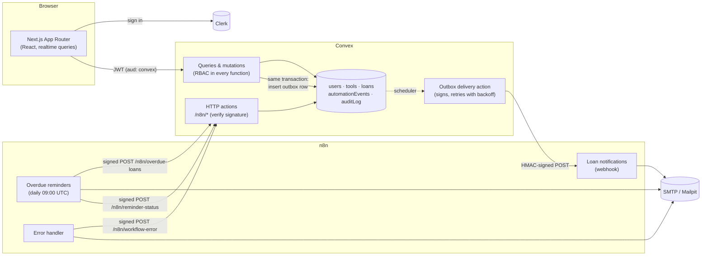

**Request lifecycle.** `requested → approved → returned`, or `requested → declined | cancelled`. An approved loan whose end date has passed is *overdue*. That state is derived, not stored.

**How a notification travels.**

1. A mutation such as `loans.approve` changes the loan **and** inserts an `automationEvents` row (`kind: notification`, `status: pending`) **in the same transaction**. This is the transactional-outbox pattern: a status change can never commit without its notification, and the reverse is also true.
2. The mutation schedules `automation.deliverNotification`. That action builds a minimal payload, signs it, and POSTs it to n8n with a 10-second timeout.
3. On a 2xx the row becomes `delivered`. Otherwise it is retried after 10 s, 1 min, 5 min and 30 min, then marked `failed`, which shows up in **Admin → Automation**. Nothing fails silently.
4. n8n verifies the signature over the raw body, drops duplicates, sends the email, and only then remembers the event id.

**How an overdue reminder travels.** Every day at 09:00 UTC, n8n signs a request to `/n8n/overdue-loans`. Convex decides what "today" is, so a caller can't shift it. For each loan, n8n sends the email and writes `sent` or `failed` back with the idempotency key Convex supplied (`reminder:<loanId>:<date>`).

---

## Roles and access control

Identity comes **only** from the verified Clerk JWT (`ctx.auth`), never from function arguments. Every public Convex function starts with `requireUser(ctx)` or `requireAdmin(ctx)` (`convex/lib/auth.ts`) and then checks ownership against the database row.

| Action | user | admin | Check |
| --- | --- | --- | --- |
| Read the public list (name and category) | ✓ (signed out too) | ✓ | none: only safe fields are returned |
| Browse with availability, request to borrow | ✓ | ✓ | signed in; can't borrow your own tool |
| Create a listing | ✓ | ✓ | signed in |
| Edit or delete a listing | own only | own only | `tool.ownerId === viewer._id` |
| Approve, decline, mark returned | own tools only | own tools only | `loan.lenderId === viewer._id` |
| Cancel a request | own requests only | own requests only | `loan.borrowerId === viewer._id` |
| Remove **any** listing (with a reason) | ✗ | ✓ | `requireAdmin` |
| View all loans, people, audit log, automation health | ✗ | ✓ | `requireAdmin` |
| Grant or revoke Trusted Lender | ✗ | ✓ | `requireAdmin` |
| Make someone an admin | ✗ | ✗ | `internalMutation`: only someone with deploy access, via the CLI |

* New users are always `role: "user"`. Nobody can promote themselves from the browser.
* The role lives in Convex rather than in Clerk metadata, so authorization has one source of truth that the tests can exercise.
* The Next.js proxy (`src/proxy.ts`) only redirects signed-out visitors, as a UX convenience. Removing it would not expose any data.
* Mutations are serializable in Convex, so two concurrent approvals of overlapping dates can't both succeed.
* Errors are typed `ConvexError({ code, message })` with user-safe messages (`UNAUTHENTICATED`, `FORBIDDEN`, `NOT_FOUND`, `INVALID_INPUT`, `CONFLICT`).

---

## Securing the Convex ↔ n8n integration

### Signatures

```
X-LendLoop-Timestamp: 1763452800
X-LendLoop-Signature: v1=hex(HMAC_SHA256(secret, "<timestamp>.<raw body>"))
```

* **Both directions are signed and verified.** Convex signs webhooks to n8n, and n8n signs every call to Convex.
* **Two secrets, one per direction** (`LENDLOOP_SECRET_CONVEX_TO_N8N`, `LENDLOOP_SECRET_N8N_TO_CONVEX`). A leaked secret only lets an attacker impersonate one side.
* **Exact bytes.** The n8n webhook uses *Raw Body* and verifies the bytes Convex signed, not a re-serialised copy. Convex reads `request.text()` before parsing.
* **Replay protection.** The timestamp is inside the signed string, and requests more than 5 minutes old are rejected.
* **Constant-time comparison** in both places (`crypto.timingSafeEqual` in n8n, an XOR loop over Web Crypto output in Convex).
* Receivers answer `401 invalid_signature` without saying which check failed. The reason goes to the logs.
* Convex caps request bodies at 16 KB and validates them field by field.

### Idempotency

| Where | Key | Effect |
| --- | --- | --- |
| Outbox row | `notification:<loanId>:<type>` | A transition can only enqueue one notification |
| n8n notification workflow | event id, kept in workflow static data | A retried webhook after a successful send returns `200 duplicate` and sends no second email. The id is stored only *after* the email is sent, so a retry after a failure still delivers |
| Reminder write-back | `reminder:<loanId>:<YYYY-MM-DD>` (issued by Convex) | Duplicate `sent` calls are no-ops. A `failed` then `sent` sequence upgrades the same row. `reminderCount` increments once |
| Overdue list | `lastReminderOn` | A loan reminded today isn't returned again today |
| Error reports | `workflow_error:<executionId>` | One row per failed execution |

### Failures are visible

* **Convex → n8n:** retries with backoff (4 retries), then `failed`, shown in **Admin → Automation** with the last error.
* **n8n nodes:** HTTP and SMTP nodes make up to 3 tries, 3 s apart.
* **A reminder that still can't be sent** goes down the node's error output and is written back as `failed`, with the SMTP error. The next run retries it.
* **Any workflow that fails** triggers **LendLoop · Error handler**. It records the failure in Convex (`/n8n/workflow-error`) and emails the on-call address. Each of those two steps continues if the other fails.
* **If n8n isn't configured at all,** notifications are recorded as `skipped` with the reason, never dropped.

All of the above was exercised end to end against a running n8n: forged signature → 401; replayed event → `duplicate`; SMTP down → error workflow, `failed` write-back, then Convex retry → `delivered` once SMTP returned.

---

## Data minimisation

| Who | Sees |
| --- | --- |
| Signed-out visitor | Tool **name and category** only. No owner, description or availability |
| Signed-in neighbour | Tool details and availability, plus the owner's **first name** and Trusted badge. Never emails or last names |
| Lender | The borrower's first name and their optional message (it's addressed to them) |
| Admin | Full names and emails, for moderation |
| **n8n: notification webhook** | Recipient's **first name and email**, tool name, dates, loan status, a relative link. **Not** the other party's name or email, and not the free-text message |
| **n8n: overdue list** | Borrower's first name and email, tool name, end date, days overdue |
| Convex outbox and audit log | Ids and status. The webhook payload is built at send time and never stored, so no extra copy of anyone's email accumulates |

Other choices along the same lines: listings are **soft-deleted**, so history and the audit trail stay intact, and the audit log is append-only and readable by admins only. A test asserts that the webhook payload contains no last names, no counterparty details and no message text.

---

## The n8n workflows

Exported JSON lives in [`n8n/workflows/`](n8n/workflows). The Code-node logic is kept as real JavaScript in [`n8n/code/`](n8n/code) so it can be reviewed and diffed, and `npm run n8n:build` regenerates the JSON from it.

**LendLoop · Loan notifications.** Webhook → verify signature → duplicate check → compose → SMTP (with retries) → remember the event id → 200. A bad signature gets 401.

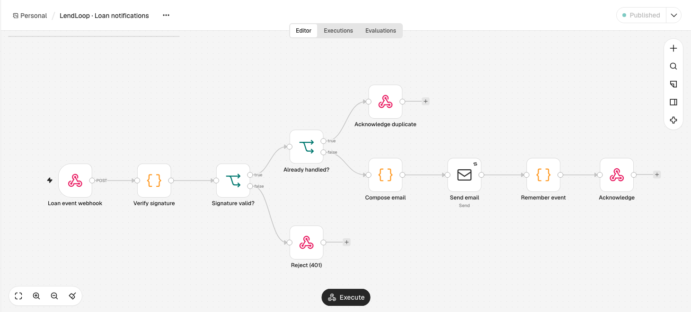

**LendLoop · Overdue reminders.** Daily schedule (or a manual run) → signed fetch → one email per loan → `sent` or `failed` write-back.

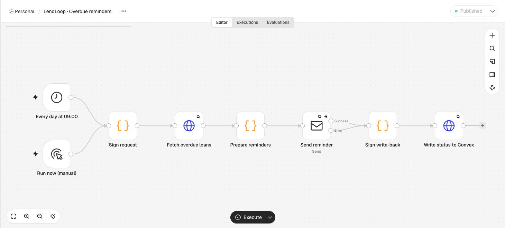

**LendLoop · Error handler.** Error Trigger → signed report to Convex, plus an alert email.

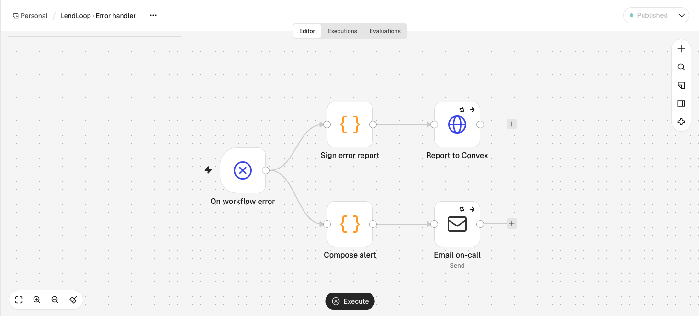

The workflows reference the SMTP credential **by id and name only**. `n8n/credentials/smtp-mailpit.json` contains just the Mailpit host, which has no password.

---

## Tests

```bash
npm run check     # tsc + eslint + vitest
```

There are 16 backend tests (`convex/lendloop.test.ts`, using [`convex-test`](https://docs.convex.dev/testing/convex-test)). They run the real functions against an in-memory Convex and cover:

* signed-out access, a user calling admin functions, and admin powers;
* ownership on edit, delete, approve, decline, return and cancel;
* date validation, self-borrowing, duplicate requests, overlapping bookings, and deleting a tool while it's out on loan;
* one outbox row per transition, a minimal payload, *skipped* when n8n is unconfigured, and retry → *failed* (also checking that the outgoing signature verifies);
* HTTP endpoints: unsigned, wrong-secret, stale and tampered requests rejected; idempotent `failed → sent → duplicate` write-backs; error reports de-duplicated.

The UI was also driven end to end in a headless browser (sign-in, list, request, approve, admin), and the n8n workflows were run against Mailpit, including the failure scenarios listed above.

---

## What I'd change for production

Short version (details in [docs/PRODUCTION.md](docs/PRODUCTION.md)):

1. **Hosting:** Convex cloud (prod deployment), Vercel for Next.js, and n8n Cloud or self-hosted n8n in **queue mode** with Postgres and workers behind TLS. Replace Mailpit with a transactional email provider (SES, Postmark) behind the same n8n credential.
2. **Secrets:** a secret manager, with **rotation** that accepts two keys at once (`v1=` already leaves room for versioning). Separate secrets per environment.
3. **Durability:** store n8n's de-duplication ids in a database table rather than workflow static data, add a Convex cron that sweeps `pending` outbox rows older than N minutes, and cap the retry queue.
4. **Scale:** paginate lists (`usePaginatedQuery`) instead of a 200-row cap, keep counters for admin stats, and page the overdue query.
5. **Users:** sync users with Clerk webhooks (`user.updated` / `user.deleted`, verified with Svix) so profile changes and deletions propagate; add an account-deletion and data-export flow.
6. **Observability:** Sentry in the app, Convex log streaming to Datadog, and alerts on `failed` outbox rows and error-workflow runs. Today they are visible in the admin page; production should page someone.
7. **Abuse and compliance:** rate-limit mutations and the HTTP endpoints, add CSP and security headers, set a retention policy for audit and automation rows, and offer a notification opt-out.

---

## Project structure

```
convex/
  schema.ts            tables, indexes and validators
  lib/auth.ts          requireUser / requireAdmin: identity only from ctx.auth
  lib/signing.ts       HMAC sign/verify (Web Crypto), constant-time compare
  lib/notify.ts        transactional outbox + per-loan activity
  tools.ts loans.ts users.ts admin.ts   public API (each function checks the caller)
  automation.ts        outbox delivery and retries, overdue list, write-backs
  http.ts              signed endpoints for n8n
  seed.ts              demo data (internal)
  lendloop.test.ts     backend tests
src/
  app/page.tsx         public landing page
  app/(app)/*          signed-in pages (browse, listings, requests, incoming, admin)
  components/          UI kit, dialogs, app shell, loan cards
  proxy.ts             Clerk: redirect signed-out visitors
n8n/
  workflows/*.json     exported workflows (no secrets)
  code/*.js            Code-node sources (verify/sign/compose)
  credentials/         SMTP credential for Mailpit (no secret)
  scripts/             bootstrap.sh (import + publish), build-workflows.mjs
docker-compose.yml     n8n + Mailpit (+ one-shot bootstrap)
scripts/setup-local.mjs  generate secrets, write n8n/.env, set Convex env
```

---

<sub>Built with help from an AI coding assistant, which the brief allows. Every design decision is documented in [docs/DECISIONS.md](docs/DECISIONS.md).</sub>
